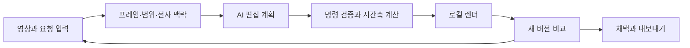

# AI 비디오 편집 요청 앱 기획

기준일: 2026년 10월 14일 · 대상 저장소: [Muuuuoouuun/video_-interference](https://github.com/Muuuuoouuun/video_-interference)

첫 사용자는 혼자 영상을 제작하는 사용자다. 영상의 프레임이나 구간을 선택하고 글, 그림, 음성, 참고 이미지로 수정 의도를 전달하면, AI가 실행 가능한 편집 계획을 만들고 앱이 새 영상 버전을 렌더한다. 사용자는 이전 버전과 비교해 결과를 채택하거나 추가 지시한다.

권장 출발점은 **브라우저에서 사용하는 작업 화면 + 로컬 편집 엔진**이다. 원본과 결과는 컴퓨터에 보관하고, AI 분석에 필요한 선택 프레임, 요청, 참고 자료와 전사용 음성을 API에 전달한다. UI와 편집 엔진을 분리해 사용성이 검증되면 데스크톱 앱으로 묶는다. 클라우드 AI를 쓰는 구성은 완전한 오프라인 앱이 아니다.

## 제품 목표와 초기 범위

핵심 목표는 사용자가 타임라인을 직접 조작하는 시간을 줄이고, 원하는 변경을 정확히 지시하고 검수하게 하는 것이다. 단순한 댓글 저장을 넘어 실제 결과물까지 만들어야 한다.

첫 검증 범위는 짧은 광고, 릴스, 설명 영상과 이미 편집된 초안의 수정이다. 초기 샘플은 30초에서 10분 사이의 SDR MP4 영상으로 잡는다. 이 길이는 성능 보장이 아니라 개발과 검증의 우선 범위다. 최초 출력은 H.264 영상과 AAC 음성을 담은 MP4로 통일한다.

GitHub 연결 도구로 저장소 메타데이터와 루트 내용을 확인한 결과 저장소는 비어 있다. 기존 구현에 맞출 제약은 없다. 현재 로컬 작업 폴더의 ClassIn 영상 프로젝트와는 별도 제품으로 구성한다.

### 사용자가 처리할 작업

| 상황 | 요청 예시 | 앱이 만드는 결과 |
|---|---|---|
| 불필요한 장면 제거 | 4초부터 7초까지 빼줘 | 선택 범위를 삭제한 새 타임라인 |
| 시작과 끝 정리 | 이 구간만 남겨줘 | 선택 범위만 유지한 버전 |
| 템포 조절 | 12초부터 18초까지 2배속, 말소리 높이는 유지 | 영상과 음성 길이를 함께 줄인 버전 |
| 자막 추가 | 여기부터 3초 동안 이 문구를 넣어줘 | 독립 자막 레이어 |
| 위치를 지정한 그래픽 | 박스로 표시한 자리에 제목을 넣어줘 | 지정 위치의 텍스트 오버레이 |
| 참고 이미지 활용 | 이 이미지처럼 제목 색과 배치를 맞춰줘 | 지원하는 스타일 속성을 적용한 제목 |
| 실제 이미지 삽입 | 이 PNG를 8초부터 10초까지 오른쪽에 넣어줘 | 참조 이미지와 구분된 삽입 에셋 |
| 음성으로 지시 | 녹음으로 여기 컷을 줄이고 자막을 바꿔줘 | 전사된 지시와 편집 명령 목록 |

## Frame.io에서 차용할 검수 방식

Frame.io의 프레임 댓글, I/O 범위 댓글, 위치 핀, 화살표·박스·자유 드로잉과 첨부 방식은 요청 대상을 정확히 지정하는 데 유용하다. 이를 우리 앱의 요청 작성 흐름에 적용한다. [Frame.io 댓글 공식 문서](https://help.frame.io/en/articles/9105251-commenting-on-your-media).

버전 기록과 두 버전의 나란히 비교도 차용한다. Frame.io의 영상 비교는 연결된 재생으로 설명할 수 있으며, 공식 문서의 슬라이더 오버레이와 픽셀 차이 기능은 정적 자산용이다. [버전 관리](https://help.frame.io/en/articles/9101068-versioning-in-frame-io), [비교 뷰어](https://help.frame.io/en/articles/9952618-comparison-viewer).

Frame.io도 전사, 자막, AI 검색 기능을 제공한다. 따라서 제품의 차별점은 **다양한 방식으로 남긴 요청을 편집 계획과 실제 영상으로 연결하는 과정**에 둔다. [전사와 자막](https://help.frame.io/en/articles/10966531-frame-io-transcription-overview), [AI 검색](https://help.frame.io/en/articles/9101079-enhanced-search-with-ai-search).

음성 파일 첨부는 Frame.io 공식 문서에서 확인된다. 우리 앱의 직접 녹음과 지시 추출은 자체 제안 기능이다.

## 핵심 사용 흐름

1. **영상 열기**: 파일을 가져오고 원본 정보, 썸네일, 재생용 프록시를 준비한다. 전사는 필요한 경우 생성한다.
2. **대상 지정**: 현재 프레임, I/O 범위, 화면의 위치 또는 전사 문구를 선택한다.
3. **요청 작성**: 글, 드로잉, 음성, 이미지 참고를 한 요청 카드에 묶는다.
4. **AI 해석**: 카드마다 이해한 변경과 사용할 에셋을 표시한다. 명확하지 않은 부분은 해당 카드에서 보완한다.
5. **미리보기 생성**: 선택한 요청들을 새 버전에 실행한다. 원본과 채택된 버전은 보존한다.
6. **비교와 채택**: 요청별 결과를 확인하고 새 버전을 채택한다. 다음 요청은 보고 있는 버전에 붙는다.
7. **내보내기**: 채택한 편집 프로젝트에서 최종 MP4를 렌더한다. 필요하면 SRT/VTT도 별도로 내보낸다.

요청을 여러 개 모아 한 번에 미리보기를 생성할 수 있게 한다. 명확한 기본 편집은 새 미리보기까지 자동 처리하고, 결과 채택은 사용자가 한다. 자동 처리도 요청 제출 또는 선택 요청 실행 이후에 시작하며 입력 중에는 렌더하지 않는다. 계획을 확인하는 별도 팝업을 매번 띄우기보다 요청 카드 안에 해석 내용을 보여준다. 충돌하거나 실행 대상이 불명확한 요청만 보류한다.

## 작업 화면 구성

데스크톱 작업 화면 하나에 영상, 요청, 시간축을 함께 배치한다. 로그인과 팀 대시보드는 초기 화면에 필요하지 않다.

```text
┌ 프로젝트 이름 ─ 현재 버전 ─ 이전 버전 비교 ─ 내보내기 ┐
│                                                    │
│          영상 플레이어              │ 요청 목록     │
│      위치 핀 / 드로잉 표시           │ 시간·구간     │
│                                    │ 글·음성·참고  │
│      재생 / 프레임 이동 / 보기 배속   │ AI 해석·상태  │
├────────────────────────────────────┤              │
│  썸네일 시간축 / I·O / 요청 마커      │ 요청 작성     │
│  선택 구간의 작업 버튼               │ 미리보기 생성 │
└────────────────────────────────────┴──────────────┘
  필요할 때 열기: 에셋 보관함 / 전사 / 버전 기록
```

| 영역 | 주요 동작 |
|---|---|
| 플레이어 | 프레임 이동, 보기 배속, 선택 구간 반복 재생 |
| 드로잉 도구 | 핀, 사각형, 화살표, 자유선, 지우기 |
| 시간축 | I/O 선택, 요청 마커, 요청 범위, 썸네일 확대 |
| 요청 카드 | 원문, 범위, 첨부, AI 해석, 상태, 재실행 |
| 선택 구간 작업 | 구간 삭제, 구간만 유지, 출력 속도 변경 |
| 전사 | 문구를 클릭해 이동하거나 선택 문구로 범위 요청 생성 |
| 버전 비교 | 이전/새 버전, 대응 장면 이동, 요청별 변경 확인 |

단축키 제안은 Space 재생, 좌우 프레임 이동, I/O 범위 지정, Escape 선택 해제다. 텍스트 입력 중에는 플레이어 단축키가 작동하지 않도록 한다. 재생 중 요청 입력을 시작하면 일시정지한다.

### 반드시 구분할 입력

| 입력 | 기본 의미 | 실제 결과에 들어가려면 |
|---|---|---|
| 드로잉 | AI에게 위치와 의도를 설명하는 메모 | 이 표시를 영상에 넣기 또는 그래픽 생성 요청 |
| 보기 배속 | 검수할 때 플레이어만 빠르게 재생 | 선택 구간 출력 속도 변경 요청 |
| I/O | 요청이 적용될 범위 | 삭제 또는 유지 등 작업을 선택 |
| 참고 이미지 | 색, 배치, 분위기를 설명하는 자료 | 삽입 이미지 역할을 선택 |
| 음성 댓글 | 편집 지시를 녹음한 자료 | 본편 음성 에셋으로 별도 지정 |

드로잉과 음성 댓글은 기본적으로 결과 영상에 포함하지 않는다. 음성 지시는 전사 내용을 수정할 수 있어야 하며, 이를 최종 자막 문구와도 구분한다. 이미지 참고는 우선 색상, 위치, 크기, 텍스트 스타일처럼 구현 가능한 속성을 해석한다.

## AI와 편집 엔진 구성



AI는 지원되는 작업 목록 안에서 구조화된 편집 계획을 만든다. 편집 엔진은 그 계획을 검증하고 같은 입력에 대해 같은 시간축과 결과를 만든다. 모델이 생성한 셸 명령이나 임의 코드를 실행하는 방식은 채택하지 않는다.

### 실행 가능한 초기 명령

| 명령 | 필요한 값 | 첫 버전의 제한 |
|---|---|---|
| remove_range | 대상 구간 | 범위 밖 영상과 음성을 이어 붙임 |
| keep_range | 대상 구간 | 하나의 연속 구간부터 지원 |
| set_speed | 구간, 속도, 음성 정책 | 일정 배속, 속도 램프는 후속 |
| add_caption | 구간, 문구, 스타일 | 독립 자막 레이어 |
| update_caption | 자막 ID, 수정 문구 | 앱에서 생성하거나 가져온 자막 대상 |
| add_text | 구간, 위치, 문구, 스타일 | 제목과 간단한 텍스트 그래픽 |
| add_image | 구간, 에셋 ID, 위치, 크기 | 정적 PNG/JPEG 오버레이 |
| add_shape | 구간, 도형, 위치, 스타일 | 고정된 박스·선·화살표 |
| set_audio | 구간, 음량 또는 음소거 | 음성 분리와 재합성은 후속 |

첫 화면의 수동 작업 버튼도 이 명령 체계를 사용한다. 먼저 AI 없이 명령과 렌더가 동작하게 만든 뒤 자연어 해석기를 붙인다. 이렇게 해야 AI 해석 문제와 편집 엔진 문제를 구분할 수 있다.

FFmpeg의 trim/atrim, setpts/asetpts, atempo, overlay, subtitles 등을 사용해 명령을 렌더로 연결한다. 자막 필터는 libass가 포함된 빌드가 필요하며 한글 폰트도 렌더 설정에 명시한다. [FFmpeg 필터 문서](https://ffmpeg.org/ffmpeg-filters.html).

### 요청을 해석할 맥락

요청 원문, 보고 있는 버전, 선택 범위, 시작·중간·끝 프레임, 해당 구간 전사, 드로잉, 첨부 역할과 기존 레이어 정보를 함께 전달한다. 모든 영상을 매번 전체 분석하는 구성은 피하고, 선택한 범위를 기본 분석 단위로 삼는다. 맥락이 부족하면 추가 프레임이나 앞뒤 구간을 가져온다.

삭제와 자막 추가가 같은 구간에 걸리는 등 결과가 충돌하면 계획에서 표시한다. 같은 기준 버전의 여러 요청은 모두 그 버전에 대한 앵커를 먼저 해결하고, 삭제·배속을 반영한 뒤 오버레이의 새 시간을 계산한다. 요청 입력 순서대로 숫자 타임스탬프를 덮어쓰면 안 된다.

미지원 기능은 가능한 작업처럼 꾸며 실행하지 않는다. 해당 요청을 보류하고 지원되는 대안을 표시한다. 미리보기 실패와 AI 해석 실패는 서로 다른 상태로 기록한다.

계획에는 기준 버전과 프로젝트 해시를 고정한다. 해석 중 다른 편집이 채택되면 이전 계획을 새 버전에 조용히 적용하지 않는다. 기존 기준 버전의 별도 미리보기로 만들거나 새 버전에 맞춰 다시 해석한다. 초기 렌더 큐는 한 번에 한 작업을 실행한다.

렌더 시작 시 base_version_id, plan_hash, request_revision을 고정한다. 이후 요청을 수정해도 실행 중인 계획은 바뀌지 않는다. 새 수정은 다음 계획에 반영하고, 이전 결과에는 어느 요청 내용으로 만들었는지 표시한다. 미리보기 버전은 렌더 완료만으로 채택되지 않는다.

### 컷과 레이어가 겹칠 때의 규칙

선택 범위에 붙인 자막과 그래픽은 기본적으로 해당 장면을 따라간다. 범위 일부가 삭제되면 살아 있는 부분에만 표시하고, 배속을 적용하면 노출 길이도 같은 비율로 변한다. 범위가 여러 출력 구간으로 나뉘면 레이어도 그 구간들로 나눠 렌더한다.

사용자가 3초 동안 표시처럼 결과 영상의 노출 시간을 지정하면, 시작 위치는 장면을 따라가고 길이는 출력 시간 기준으로 유지한다. 이 두 정책은 편집 계획에 명시한다. 시작 장면 전체가 삭제되면 임의의 다른 장면에서 표시하지 않는다. 같은 구간에 서로 다른 배속을 요청하면 자동으로 곱하지 않고 충돌로 표시한다.

미리보기와 최종 출력은 같은 시간축 컴파일 결과를 사용한다. 미리보기의 해상도만 낮추고 컷 경계와 레이어 타이밍을 별도로 계산하지 않는다.

## 시간축과 공간 좌표 설계

댓글에 초 단위 숫자만 저장하면 첫 컷 수정 이후 위치가 틀어진다. 요청 작성 당시 화면의 시간과 실제 원본 위치를 함께 보존해야 한다.

| 저장할 정보 | 목적 |
|---|---|
| origin_version_id와 화면 시간 범위 | 사용자가 무엇을 보며 요청했는지 보존 |
| source_asset_id와 원본 PTS 및 time base | 원본의 실제 프레임과 구간 식별 |
| clip_instance_id와 분할 계보 | 같은 원본이 반복 사용될 때 대상 구분 |
| 시간축 변환 정보 | 컷과 배속 이후 대응 위치 계산 |
| 자막·오버레이 layer_id | 특정 편집 레이어 수정 |

PTS는 미디어의 각 프레임에 붙은 재생 시각이며, time base는 그 정수의 시간 단위다. 내부에서 정수 시간값과 유리수 비율을 사용하고 UI에서만 초와 timecode로 표시한다. 선택 범위는 시작을 포함하고 끝을 제외하는 방식으로 통일한다. 가변 프레임레이트 영상은 단순히 초에 평균 fps를 곱해 원본 프레임을 찾지 않는다.

재생용 프록시에도 원본으로 돌아가는 시간 매핑을 둔다. 브라우저의 requestVideoFrameCallback은 표시된 프레임의 mediaTime을 읽는 데 활용하되, 정확한 프레임 선택은 워커의 원본 프레임 인덱스와 연결한다. 프록시의 seek 위치와 원본 편집점을 같은 값으로 가정하지 않는다. 정밀 선택 모드에서는 원본 프레임 이미지와 PTS로 위치를 확정하고, I/O는 그 프레임 경계에 맞춘다. [브라우저 프레임 콜백 문서](https://developer.mozilla.org/en-US/docs/Web/API/HTMLVideoElement/requestVideoFrameCallback).

예를 들어 60초 원본의 12~18초를 2배속으로 만들면 결과 길이는 57초다. 원본의 24초 장면은 새 버전의 21초에 나타난다. 원본 24초에 붙은 요청도 그 장면으로 이동해야 한다.

대상 구간이 삭제되면 요청은 삭제된 구간 상태로 남긴다. 가장 가까운 살아 있는 장면에 자동으로 붙이지 않는다. 동일 원본을 두 번 배치했을 때는 클립 인스턴스로 구분한다. 한 요청의 범위가 여러 클립을 걸치면 앵커 세그먼트를 여러 개 저장한다.

비교 뷰어도 시간이 달라진 두 영상에 동일한 초를 강제로 적용하지 않는다. 원본 앵커를 기준으로 대응 장면을 찾고, 삭제된 구간은 대응 장면 없음으로 표시한다. 첫 버전에서 연속적인 대응 재생이 어렵다면 요청 단위로 전후 구간을 비교하는 방식부터 구현한다.

드로잉 좌표는 영상이 실제로 표시되는 영역 안의 0~1 비율로 저장한다. 플레이어 전체나 검은 여백을 기준으로 저장하지 않는다. 회전, 화면 비율, 크롭 변환도 함께 기록해 그래픽이 다른 위치로 이동하지 않게 한다. 움직이는 대상을 따라가는 트래킹은 별도 기능으로 취급한다.

녹음 시작 시점에 선택 프레임과 범위를 고정해 음성 지시의 앵커로 저장한다. 녹음하는 동안 플레이헤드가 움직여도 지시 대상은 바뀌지 않는다.

## 저장 구조와 버전 관리

| 객체 | 주요 내용 |
|---|---|
| Project | 프로젝트 이름, 설정, 채택 버전 |
| Asset | 원본·이미지·음성 파일, 미디어 정보, 해시 |
| Version | 부모 버전, 편집 프로젝트 스냅샷, 렌더 결과 |
| ClipInstance | 원본 참조, 원본 구간, 배속, 시간축 배치, 계보 |
| Request | 입력 원문, 작성 버전, 대상 앵커, 상태 |
| Annotation | 핀·선·박스, 영상 좌표, 작성 프레임 |
| Attachment | 에셋 참조, 참고/삽입/지시 역할 |
| EditPlan | 기준 버전, 명령 목록, 해결되지 않은 질문 |
| RenderJob | 계획 해시, 진행 상태, 출력 경로, 실패 정보 |

초기 요청 상태는 초안 → 해석됨 → 실행 중 → 미리보기 준비 → 채택으로 잡는다. 보완 필요, 실패, 취소 상태도 둔다. 한 요청에서 여러 명령이 나왔을 때는 명령별 결과를 기록하고, 실제 반영된 버전과 연결한다. 부분 실패를 전체 완료로 표시하지 않는다.

버전은 영상 파일뿐 아니라 편집 프로젝트 스냅샷을 보관한다. v3를 만들 때 v2의 압축된 출력물을 계속 재편집하지 않고 원본과 스냅샷에서 렌더한다. 이렇게 해야 반복 수정의 화질 저하를 줄이고 이전 상태를 복원할 수 있다.

프로젝트마다 SQLite에 요청과 작업 상태를 보관하고, 버전별 편집 상태는 스키마 버전이 있는 JSON으로 저장한다. JSON이 편집 상태의 기준이며 SQLite에는 그 경로와 해시를 보관해 중복 저장으로 인한 불일치를 줄인다. 내보내기만으로 요청 기록과 프로젝트 상태를 잃지 않게 한다.

## 웹과 로컬 구성 비교

| 방식 | 적합한 상황 | 비용과 구현 부담 | 이번 선택 |
|---|---|---|---|
| 호스팅 웹과 서버 렌더 | 외부 사용자와 공유, 여러 기기 | 업로드, 저장, 렌더 서버와 계정 필요 | 협업 단계 |
| 브라우저만 사용 | 작은 파일의 가벼운 작업 | 코덱·메모리·렌더 제약을 먼저 검증해야 함 | 주 렌더 경로에서 제외 |
| 웹 UI와 로컬 워커 | 혼자 로컬 원본으로 반복 수정 | 실행 도구와 파일 가져오기 설계 필요 | 첫 버전 |
| 데스크톱 앱 | 설치 후 파일을 직접 여는 일상 사용 | 패키징, 플랫폼별 코덱과 바이너리 검증 | 사용 흐름 검증 뒤 |

ffmpeg.wasm 공식 FAQ는 native FFmpeg보다 느리고 입력 파일 크기 제한이 있다고 설명한다. 처음부터 브라우저 렌더에 맞추기보다 native FFmpeg를 사용하는 편집 엔진을 권장한다. 실제 처리 시간은 대상 컴퓨터와 샘플 영상으로 측정한다. [ffmpeg.wasm FAQ](https://ffmpegwasm.netlify.app/docs/faq/).

### 권장 기술 구성

| 계층 | 제안 |
|---|---|
| 작업 화면 | React, TypeScript, Vite |
| 위치 표시 | 영상 위 SVG 오버레이, 자유선은 벡터 경로 저장 |
| 로컬 API와 작업 큐 | Node.js와 TypeScript, 처음에는 렌더 1개씩 실행 |
| 미디어 처리 | ffprobe로 검사, native FFmpeg로 프록시·컷·배속·합성 |
| 자막과 그래픽 | 자막 데이터 + ASS 또는 PNG/SVG 기반 합성 |
| 상태 저장 | SQLite와 버전별 프로젝트 JSON |
| AI | 멀티모달 LLM과 음성 전사 공급자를 각각 어댑터로 연결 |
| 데스크톱 패키징 | Tauri를 후속 후보로 검증 |

웹 파일 선택에서 얻는 File 객체를 로컬 워커의 절대 경로로 취급하면 안 된다. 첫 개발판은 localhost API에 파일을 스트리밍해 프로젝트의 미디어 폴더로 가져온다. UI는 asset_id로 접근하고, 워커가 읽기·시킹을 위한 미디어 응답을 제공한다. 데스크톱 버전에서는 OS 파일 선택과 원본 경로 참조를 추가해 대용량 파일 복사를 줄일 수 있다. [브라우저 File API 문서](https://developer.mozilla.org/en-US/docs/Web/API/File_API/Using_files_from_web_applications).

워커는 localhost에 바인딩하고 세션 토큰으로 UI 요청을 확인한다. AI API 키는 워커가 보관한다. 실행 파일은 고정하고 인수는 구조화된 값으로 전달한다. 원본 경로와 결과 경로는 별도로 관리한다. 렌더 취소, 오류 표시와 앱 재시작 후 상태 복구를 초기 작업 큐에 포함한다.

Tauri는 외부 바이너리를 sidecar로 포함하는 방식을 공식 제공한다. 후속 패키징에서는 FFmpeg와 워커를 어떤 플랫폼별 바이너리로 배포할지 검증한다. [Tauri sidecar 문서](https://v2.tauri.app/develop/sidecar/).

현재 ClassIn 로컬 폴더에는 Remotion 기반 영상 제작 코드가 있다. 이 경험은 후속 텍스트 애니메이션 템플릿에 활용할 수 있다. 초기 컷·배속·정적 그래픽 엔진은 FFmpeg로 만들고, Remotion은 고급 모션 템플릿이 필요한 시점에 선택적으로 연결한다.

## 첫 버전에서 가능한 편집과 후속 기능

| 기능 | 우선순위 | 범위 |
|---|---|---|
| 파일 열기, 플레이어, I/O, 요청 저장 | 첫 기반 | AI 없이도 사용 가능 |
| 컷 삭제, 구간 유지, 일정 배속 | 첫 실행 | 실제 MP4 생성 |
| 자막과 텍스트 수정 | 첫 실행 | 독립 레이어 대상 |
| 정적 이미지와 간단한 도형 | 첫 실행 | 시간·위치·크기 지정 |
| 음성 지시와 참고 이미지 해석 | 첫 완성 | 전사 수정, 첨부 역할 선택 |
| 버전 비교, 되돌리기, 내보내기 | 첫 완성 | 요청과 결과 연결 |
| 전사 선택 편집, 긴 영상 탐색 | 후속 | 문장 단위 범위 지정 |
| 얼굴·물체 트래킹, 움직이는 마스크 | 후속 | 프레임 간 위치 추적 필요 |
| 장면 교체, 인페인팅, 생성 B-roll | 후속 | 외부 생성 작업과 품질 검수 필요 |
| 클라이언트 공유와 협업 | 후속 | 클라우드 저장·계정·권한 추가 |
| Premiere·Resolve·Remotion 프로젝트 연동 | 후속 | 각 포맷의 지원 범위별 어댑터 |

이미 영상 픽셀에 구워진 자막은 독립 자막 레이어처럼 문구를 바꿀 수 없다. 원본 프로젝트나 자막 없는 영상이 있으면 그 자료를 사용한다. 영상만 있다면 덮어쓰기나 인페인팅은 별도 작업이고, 첫 버전의 자막 수정 완료로 처리하지 않는다.

그래픽 생성과 장면 재생성은 결과가 확정적인 컷·자막 편집과 성격이 다르다. 우선 지원하는 텍스트·이미지·도형 템플릿으로 결과를 만들고, 생성형 모델은 후속 에셋 공급자로 추가한다.

## 개발 순서와 완료 기준

아래 단계는 의존 순서다. 일정은 아직 구현 속도나 성능을 측정하지 않았으므로 확정하지 않는다.

| 단계 | 만들 것 | 다음 단계로 넘어갈 기준 |
|---|---|---|
| 1 요청 작업 화면 | 파일 가져오기, 원본·프록시 매핑, 플레이어, I/O, 핀·그림, 댓글, 저장 | 닫고 다시 열어도 동일 프레임·범위·드로잉 복원 |
| 2 실제 편집 엔진 | 명령 스키마, 컷·배속·자막·이미지, 작업 큐, 버전 | 수동 요청으로 실제 MP4 생성, 원본 보존, 복원 가능 |
| 3 AI 요청 해석 | 맥락 수집, 구조화 계획, 지원 범위·충돌 검증 | 자연어가 올바른 명령이 되거나 보완 필요로 분류 |
| 4 음성과 레퍼런스 | 녹음·전사 수정, 참고/삽입 역할, 스타일 추출 | 지시 자료가 본편에 잘못 들어가지 않고 실제 결과 생성 |
| 5 일상 사용 | 대응 장면 비교, 내보내기, 재시작 복구, 실제 영상 검수 | 자신의 영상에서 요청부터 채택까지 반복 사용 가능 |
| 6 데스크톱 배포 | 파일 직접 참조, 바이너리 포함, 패키징 | 목표 OS에서 설치 후 파일 열기부터 렌더까지 완료 |

### 첫 통합 검증 시나리오

60초, 30fps 테스트 영상에 식별 가능한 장면, 음성, 별도 자막을 넣고 다음 작업을 수행한다.

1. 원본 24초에 위치 핀과 댓글을 남긴다.
2. 12~18초를 2배속으로 만들고 음성의 높이를 유지한다.
3. 결과 길이가 57초이고 기존 댓글이 같은 장면의 21초를 가리키는지 확인한다.
4. 다른 구간에 한국어 자막, 지정 위치의 PNG와 제목을 추가한다.
5. 삭제할 구간에도 댓글을 남기고 해당 구간을 삭제한다. 요청은 삭제된 구간으로 표시해야 한다.
6. 원본의 같은 구간을 두 번 배치하고 두 번째 클립에만 요청을 적용한다.
7. 음성 댓글과 참고 드로잉이 최종 영상에 들어가지 않는지 확인한다.
8. 이전 버전으로 복원하고 앱을 재시작한 뒤 프로젝트와 요청을 다시 연다.
9. 컷·배속을 적용한 버전에 새 자막을 추가하고 원본에서 다시 렌더한다. 미리보기와 최종 출력에서 자막의 대상 장면과 노출 길이가 같아야 한다.

시간축 계산은 정확한 값으로 검증하고, CFR 렌더의 컷 경계는 출력 1프레임 이내를 목표로 검사한다. 실제 음성 싱크는 영상 길이 검사와 별도로 확인한다. 세로 영상, 회전 메타데이터가 있는 영상, 가변 프레임레이트 영상도 가져오기와 앵커 매핑의 추가 검증 샘플로 사용한다.

AI 검증은 명확한 범위, 범위가 빠진 요청, 충돌 요청, 잘못된 에셋 역할, 지원하지 않는 생성 요청을 포함한다. 명확한 지시는 올바른 명령으로 바뀌어야 하고, 나머지는 임의로 실행하지 않고 보완 또는 미지원 상태가 되어야 한다.

성능은 가져오기, AI 해석, 미리보기 렌더, 최종 렌더 시간을 따로 측정한다. 특정 컴퓨터에서 측정하기 전에는 실시간 편집이나 렌더 속도를 약속하지 않는다.

## 저장소 구성 제안

```text
video_-interference/
  apps/web/               플레이어와 요청 작업 화면
  apps/worker/            로컬 API, 미디어 가져오기, 작업 큐
  packages/project/       프로젝트·앵커·버전 스키마
  packages/edit-engine/   시간축 계산과 명령 검증
  packages/ai/            모델·전사 어댑터와 요청 해석
  packages/renderer/      FFmpeg 실행과 합성
  docs/                   제품 기획과 기술 결정
  fixtures/               작은 검증용 미디어
```

첫 구현 목표는 **영상을 열고, 범위를 잡고, 요청을 남기고, 실제 수정 영상을 만드는 하나의 완결된 흐름**이다. 이후 음성, 참고 이미지와 모션을 같은 요청 구조에 추가한다.
